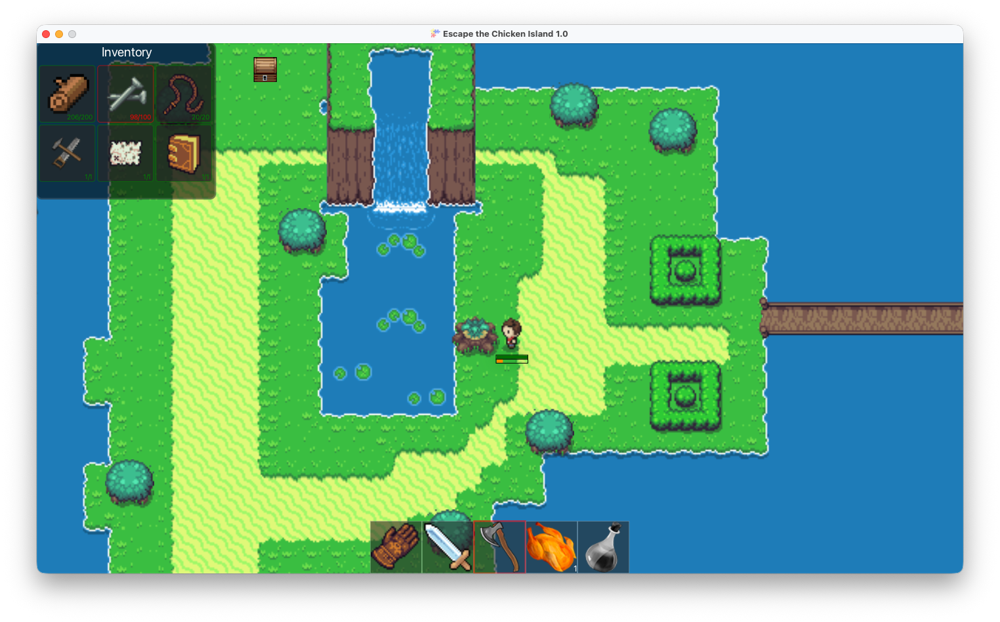

# 🐔 Escape The Chicken Island

> A 2D top-down survival game built in Kotlin with the FXGL engine, developed as part of the ACVL project at Ensimag.



---

## Concept

You're stranded on an island overrun by hostile chickens. To escape, you must gather enough resources to build a boat. Explore the island, chop trees, fight chickens, open treasure chests... and don't starve!

---

## Requirements

- **Java 17+**
- **Maven 3.6+**
- **JavaFX 20** (included via Maven dependencies)

---

## Running the game

From the project root:

```bash
./run.sh
```

Or manually:

```bash
mvn clean package
java -jar target/tp-acvl-kotlin-1.0-SNAPSHOT.jar
```

---

## Controls

| Key | Action |
|---|---|
| ←  →  ↑  ↓ | Move |
| `SPACE` | Use selected action (attack, chop, open, eat, drink) |
| `TAB` | Next action |
| `SHIFT + TAB` | Previous action |
| Mouse wheel | Cycle actions |
| `T` | Teleport (debug) |

---

## Gameplay

### Goal

Fill your inventory with all required resources. Once complete, a boat appears on the map — reach it with the **hand** selected to **win**.

### Resources to collect

| Resource | Required | Source |
|---|---|---|
| Wood | 5 | Trees (axe) |
| Nails | 200 | Treasure chests |
| String | 15 | Treasure chests |
| Tools | 1 | Treasure chests |
| Manual | 1 | Treasure chests |
| Map | 1 | Treasure chests |

### Actions

- **Hand** — interact with chests and the boat
- **Axe** — chop trees to get wood
- **Sword** — attack chickens
- **Food (chicken)** — restores 25% of the hunger bar
- **Potion** — restores 85% of health points

### Survival

Hunger increases automatically every ~8 seconds. When the hunger bar is empty, health drops every 3 seconds. Reach zero HP and it's game over.

Chickens spawn progressively up to a maximum of 10 on the map. They roam randomly and deal damage on contact.

---

## Project structure

```
src/main/kotlin/
├── ETCIApp.kt              # Entry point, FXGL setup
├── ETCIFactory.kt          # Entity factory
├── ETCIMap.kt              # Tiled map loading
├── Config.kt               # Global constants
├── EntityType.kt           # Entity types
├── component/              # FXGL components (player, NPC, boat, tree...)
├── entity/                 # Game entities (PlayerEntity, NPCEntity...)
├── events/                 # Event system (attack, hunger, death...)
├── gameplay/               # Game logic and player input
├── items/                  # Items, actions and their UI config
├── npc/                    # Animal behaviours (chicken, cow, llama...)
├── ui/                     # Inventory and action bar display
└── view/                   # Main game view
```

Built on FXGL's **Entity-Component** pattern, a custom **event system** (JavaFX EventType), and **A\* pathfinding** for NPC movement.

---

## Tech stack

- **Kotlin 2.0**
- **FXGL 17.3** — JavaFX game engine
- **Maven** — build & dependency management
- **Tiled** — map editor (`.tmx`)

---

## Documentation

The `doc/` folder contains:
- `Rendu.pdf` — full project report
- `Diagrammes/` — UML diagrams (class, sequence, use case, architecture)

Online diagrams: [Visual Paradigm](https://online.visual-paradigm.com/share.jsp?id=333538303336352d31)
